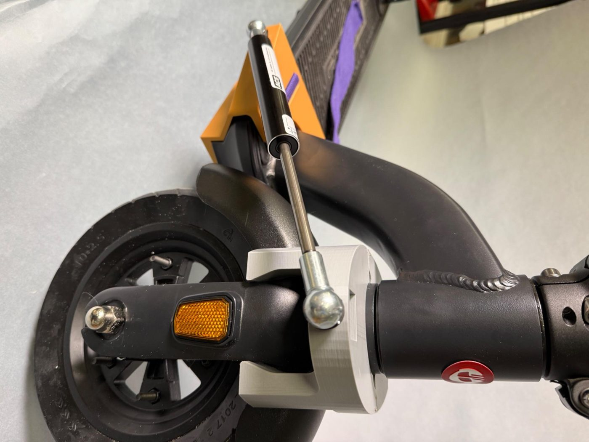
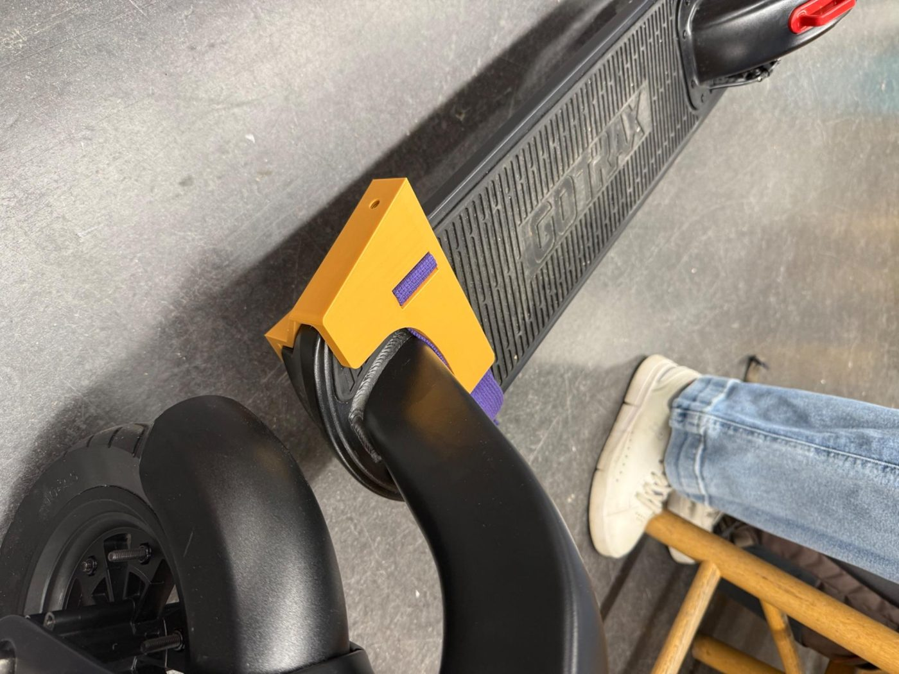
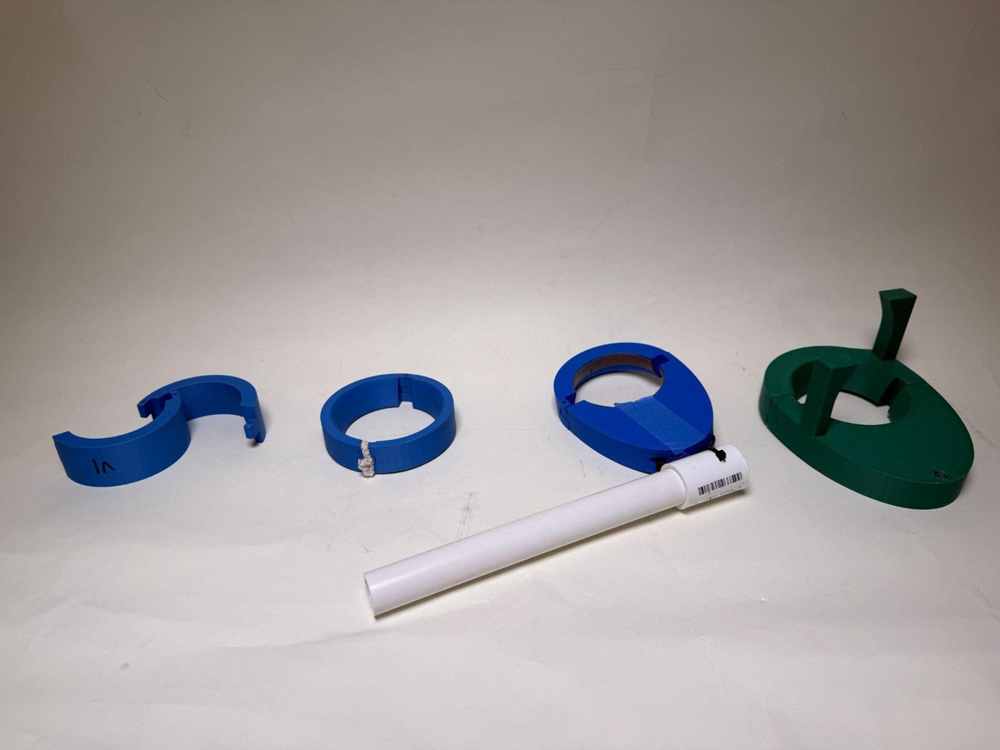
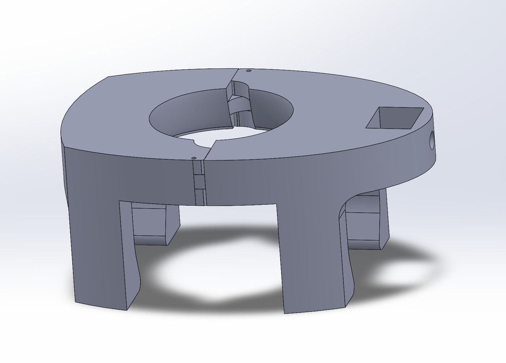
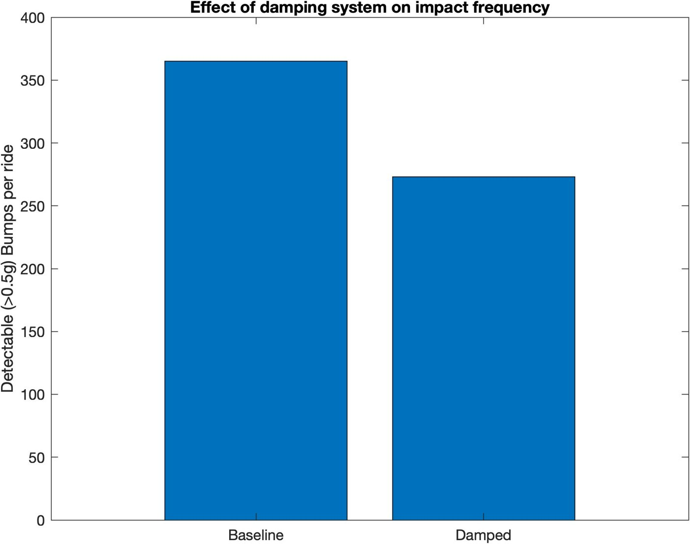
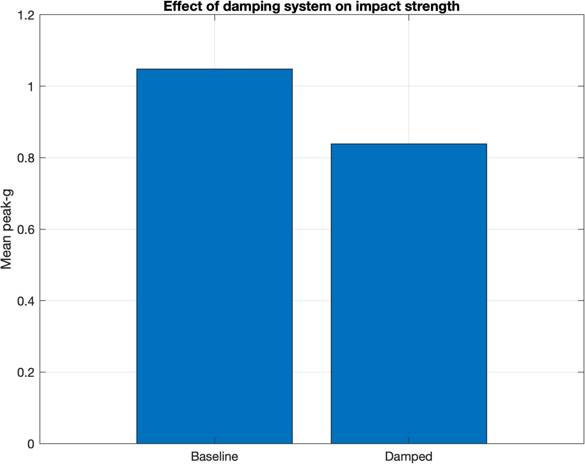

<!-- TODO: confirm the bump counts (about 365 baseline vs 273 damped) against the MATLAB output. They were read off the slide chart. -->
<!-- TODO: add anything you personally designed, built or tested beyond design for manufacturing and durability. Teammate roles from the proposal: Jack = testing and torque modeling, Mia = finance and installation, PJ = prototyping and mechanical design. -->

## The problem

Scooters have become an everyday way to get around Dartmouth's campus, but crashes are common. In our survey of 23 students, 85% of the scooter owners had been in at least one accident, and 43% of the non-owners knew someone who had. The stories followed a pattern: a wheel turned suddenly, a bump knocked the bars sideways, or the rider jumped off to avoid someone. One respondent put it as "Wheel turned. On my face."

We framed the need this way: riders on crowded, uneven paths want more control over the scooter, so a sudden wheel twitch doesn't throw them into a person, a wall, or the pavement.

## My role

I focused on design for manufacturing and durability. I worked out how the product could be built from a few molded parts, what would make it last, and how it would hold up over time. I also worked with the team on prototyping and testing.

## Process

### Defining the product

Our value proposition was a lightweight, easy-to-install steering damper that tames sudden wheel wobble without adding weight, batteries, or complexity. We turned that into measurable specs and a test for each:

- **Doesn't fight the rider.** Damping force stays below 0.2 times the average turning force at maximum turning speed.
- **Resists sudden jolts.** Damping force at least matches the average turning force at five times the normal turning speed.
- **Easy to install.** Under 15 minutes with no more than two tools in the plan. Users should be able to install it in under 5 minutes from simple instructions.
- **Survives bumps.** Mounting hardware stays attached after a hard bump event.

Before building anything, we modeled the steering as a mass-spring-damper system. The simulation showed the damped steering angle staying small while the undamped angle kept climbing. For inspiration we looked at Canyon's KIS system on mountain bikes, which uses a spring to pull the bars back toward center. Our goal was different: a damper that controls how fast the bars can turn.

### Choosing where to mount it

We sketched several mounting locations and scored five of them in a design matrix. The criteria were contact strength, wheel range of motion, serviceability, intuitive installation, environmental impact, and aesthetics. The winner, with 22 points against 16–19 for the others, was the side of the scooter at the top of the wheel, with the damper running from the scooter body to the steering shaft.

### Finding a damper

We looked at many off-the-shelf dampers. None combined self-centering, ballpark spring values, swappable springs, an adjustable damper, and an affordable price. So the prototype uses an off-the-shelf damper alone. The production vision is a custom self-centering spring-damper.

### Building and iterating

We moved from cardboard and wood mockups to 3D-printed parts, which showed us geometry problems early. The two clamps took the most iterations:

- **Base clamp (7 versions).** The final version curves to fit the scooter, has front and back stabilization points, uses a buckle for an auto-locking strap, and has a threaded M8 hole and an angled attachment point for clearance.
- **Steering shaft clamp (6 versions).** Early versions didn't fit the curvature or lacked support. Later ones added torsional supports on all sides and an easily swapped damper. Version 6 fit well and had stronger supports.

### Testing

We tested three ways:

1. **Ride test.** We logged filtered acceleration on the same campus route with and without the damper and counted detectable bumps and their peak strength.
2. **Force test.** We built a rig with a force sensor mounted 4 inches from the steering axis to measure force against rotation angle. Runs with higher damping showed lower peak rotation speeds.
3. **User test.** Seven riders tried the damped scooter and filled out a survey.

### Designing for manufacturing, the environment, and reliability

- **Lean build.** Three injection-molded parts plus one off-the-shelf damper, with purchased hardware only and no custom machining. Snap-fit, symmetrical geometry supports a tool-less assembly. The deck also projects that bringing the damper in-house at over 20,000 units could cut cost of goods sold by about 15%.
- **Environment.** No electronics or batteries, minimal material, recyclable parts, an RoHS- and REACH-compliant damper, and a modular design with an exchangeable damper and replaceable attachment parts. We proposed a product return system to recycle or refurbish units at end of life.
- **Reliability.** The damper's hydraulic fluid is rated for 3,000 hours of use. Spread over a five-year life, that is about 1.6 hours a day. Ball joints are replaceable, mounting uses standard M8 threads, and we targeted a 4–5 year lifespan for a college user.

## Result

The final prototype installed in under two minutes with one tool. Riders felt the difference: six of seven rated it 5 out of 5 for safety compared with a scooter alone, and all seven rated their sense of control 4 or 5. Their comments called the ride smoother and less twitchy. On our campus route, the damped scooter had roughly a quarter fewer detectable bumps per ride, and the average impact strength dropped as well.

The testing also showed the tradeoffs. A few riders noticed the added bulk and a slightly limited turning range, and with only seven testers the user results are directional, not conclusive. If we kept going, we would tighten the tolerances so the clamps lock on, improve the strap so it doesn't loosen, source or design a damper made for this job that allows full range of motion, fit more scooter models, and reduce the bulk.

**What I took away:** physical prototypes exposed geometry problems that CAD hid, designing one product to fit many scooters is hard, and open-ended user testing surfaced perceptions we hadn't planned to measure.
